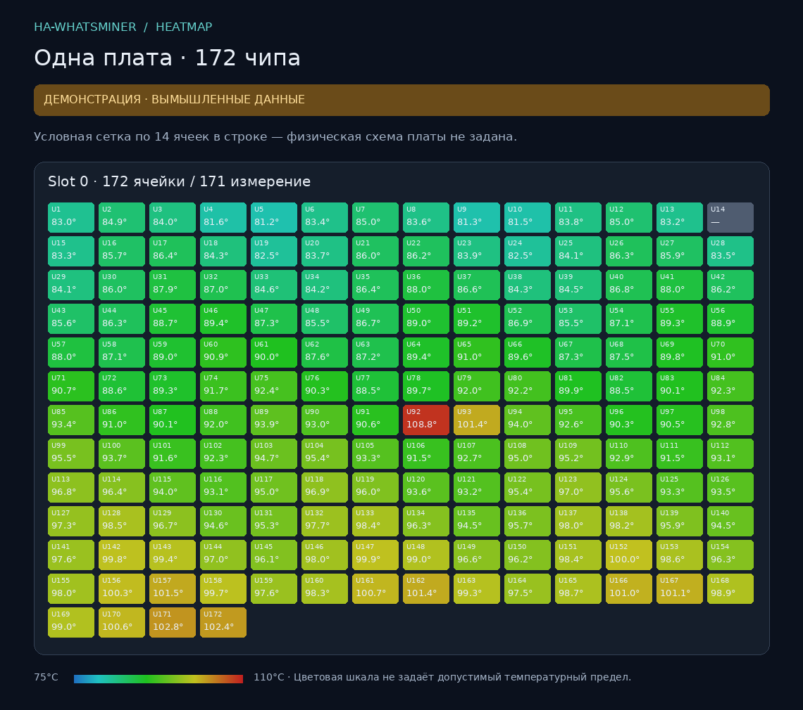

# HA-WhatsMiner

Локальная интеграция Home Assistant / HAOS для WhatsMiner. Версия **0.2.0**.
Прямое подключение к официальному API 3.x по TCP 4433, без MQTT, Node-RED и облака.

Реализованы управление мощностью в ваттах, **`set.miner.power_percent`** с выбором `normal`/`fast`, телеметрия плат и карточка **HeatMap отдельных чипов**. WEB-источник пока экспериментальный: адрес запроса и формат данных конкретной прошивки пользователя ещё не получены. Статистика min/avg/max из API не подменяет индивидуальные температуры.



## Возможности

- Температуры плат; min/avg/max чипов всего майнера и отдельно каждой платы.
- Хешрейт, частоты, количество активных чипов, вентиляторы, параметры БП и ошибки.
- Раздельные фактическая мощность, заданная мощность и действующий лимит.
- Поле мощности в ваттах с границами пользователя.
- Поле процента мощности и локальный переключатель режима применения `normal`/`fast`.
- Опциональный WEB JSON-адаптер, отдельные учётные данные WEB и статус получения.
- HeatMap: номера чипов, температуры, минимум/средняя/максимум, отклонение от медианы, отсутствующие измерения, явная схема расположения.
- Для каждого чипа предусмотрен отдельный датчик, по умолчанию выключенный в реестре сущностей. Для самой карты включать их не нужно.
- Настройка через интерфейс, несколько майнеров, опрос каждые 30 секунд по умолчанию.

## Установка

### Через HACS

Репозиторий: **https://github.com/voltsifer/HA-WhatsMiner**. Добавьте его как пользовательскую интеграцию HACS; инструкция также в [GITHUB.md](GITHUB.md).

Репозиторий публичный. Для установки:

1. HACS → меню ⋮ → «Пользовательские репозитории».
2. Добавить `https://github.com/voltsifer/HA-WhatsMiner`, тип **Integration**.
3. Скачать интеграцию и перезапустить Home Assistant.
4. Настройки → Устройства и службы → Добавить интеграцию → **HA-WhatsMiner**.

При последующих выпусках HACS позволит обновлять интеграцию оттуда. Для карточки не требуется второй репозиторий: JS находится внутри интеграции и обновляется вместе с ней.

### Вручную из архива

1. Скопируйте `custom_components/whatsminer_local` в `/config/custom_components/whatsminer_local`.
2. Проверьте путь `/config/custom_components/whatsminer_local/manifest.json`.
3. Перезапустите Home Assistant и добавьте **HA-WhatsMiner** через интерфейс.
4. Укажите IP майнера, порт **4433**, интервал **30** секунд. Первую проверку выполните с выключенными управлением и WEB-адаптером.

При обновлении с 0.1.0 замените содержимое той же папки и перезапустите HA. Внутренний домен `whatsminer_local` сохранён, чтобы существующая запись и сущности продолжили работать. Имя проекта и отображаемое имя — HA-WhatsMiner.

## Управление мощностью

В «Настроить» включите управление. В WhatsminerTool должен быть разрешён API Write. По документации производителя также требуется изменить стандартный пароль `admin`; для поля API `account` используются **`super`, `user1`, `user2`, `user3`**, а не `admin`.

Укажите пароль соответствующей API-учётной записи и границы мощности именно для вашей модели/БП. Минимум/максимум в ваттах автоматически не угадываются.

| Сущность | Действие |
| --- | --- |
| Установка мощности | `set.miner.power`, целые ватты, границы пользователя |
| Установка процента мощности | `set.miner.power_percent`, целый процент от исходной стабильной мощности |
| Режим изменения процента мощности | Выбор `normal` или `fast` для следующей явной команды; сам по себе ничего в майнер не отправляет |
| Процент мощности API | Значение `get.miner.setting → power-percent` как возвращено прошивкой, без интерпретации 0 как 100% |

**Процент — не доля паспортной мощности и не процент текущего потребления.** Производитель определяет его относительно исходной стабильной мощности после подбора частот. Приблизительный пример: если исходная стабильная мощность равна 3500 Вт, то 80% соответствует ориентиру `3500 × 80 / 100 = 2800 Вт`; измеренная мощность может отличаться.

- Диапазон API: **0–100%**. Нижняя граница интерфейса по умолчанию 50%, её можно изменить в настройках. Это ограничитель команды, а не гарантия устойчивой работы при 50%.
- `normal`: изменение за несколько минут; рекомендованный производителем режим для частой регулировки. На воздушном охлаждении доступен в Normal/Low Power; на жидкостном таких ограничений нет.
- `fast`: около секунды, с большей потерей эффективности и устойчивости; для кратковременных изменений.
- Команда действует после окончания подбора частот. Когда API явно возвращает `up-freq-finish = 0`, интеграция блокирует её до завершения. Если поле отсутствует, решение остаётся за прошивкой.
- Процент **не сохраняется майнером после перезагрузки**. Интеграция не восстанавливает его автоматически.
- В отличие от процента, `set.miner.power` в API 3.0.3+ записывает настройку в конфигурацию майнера. Во время подбора частот эта команда может вступить в силу только при следующем запуске.
- После перезагрузки интеграции локальный выбор режима возвращается к значению по умолчанию из настроек.

Подключение, изменение границ, выбор режима, опрос и перезапуск HA не отправляют команды мощности. Команда отправляется при явной установке `number`; повтор уже подтверждённого текущего значения пропускается. Потерянный ответ не вызывает автоматический повтор. Ответ `ok` не подменяет измеренное значение в HA.

Пример действия автоматизации (замените entity_id на ваш):

```yaml
action: number.set_value
target:
  entity_id: number.replace_with_actual_percent_control
data:
  value: 80
```

## WEB и HeatMap

Инструкции: [WEB_CHIPS.md](WEB_CHIPS.md), [HEATMAP.md](HEATMAP.md).

Стандартный API предоставляет сводные температуры. Для каждого чипа нужен реальный источник индивидуальных измерений. Публичного подтверждённого WEB endpoint для вашей прошивки пока нет. Поэтому адаптер выключен по умолчанию, не перебирает адреса и не имитирует показания.

Карточка уже реализована. Демо на вымышленных значениях доступно в `examples/heatmap-demo.html`. Оно не подключается к майнеру. Для открытия из корня проекта:

```bash
python -m http.server 8000
```

Затем откройте `http://localhost:8000/examples/heatmap-demo.html`.

На плате пользователя **172 чипа**; интеграция получает число и ID чипов отдельно для каждой платы из ответа WEB. Число плат не предполагается заранее. Физическое размещение чипов зависит от хешплаты. Без подтверждённой карты карточка показывает **условную сетку** с явной подписью. Схему можно задать массивом chip ID; нельзя делать вывод о физических соседях по порядку в ответе.

## Диагностика

В сети майнера с Python 3.11+:

```powershell
py tools\probe.py 192.168.1.100
```

Скрипт выполняет только чтение API. Выводит модель, прошивку, версию API и измерения, исключая соль авторизации, MAC, серийные номера и параметры пулов. Старый API 2.x на 4028 не поддерживается.

При потере API-связи сущности становятся недоступными. Ошибка WEB делает недоступными только индивидуальные чипы/карты, сохраняя доступную API-телеметрию. Cookie может истечь: автоматический вход LuCI в этой версии не реализован.

Диагностика интеграции содержит только выбранную телеметрию и сведения о модели/прошивке; настройки WEB и API с паролями/куки в неё не включаются.

## Удаление

Удалите запись HA-WhatsMiner в «Устройствах и службах», затем при необходимости папку интеграции или запись HACS. Ранее установленная мощность не восстанавливается автоматически. При необходимости явно верните исходное значение на майнере. Удаление не меняет API Write.

## Проверки и источники

См. [VALIDATION.md](VALIDATION.md). Проверки эмулятора и тестового Core не подтверждают совместимость WEB с конкретной прошивкой и не заменяют проверку реального оборудования.

- [Официальный API WhatsMiner](https://apidoc.whatsminer.com/)
- [Требования HACS к интеграциям](https://www.hacs.xyz/docs/publish/integration/)
- [Пользовательские репозитории HACS](https://www.hacs.xyz/docs/faq/custom_repositories/)
- [Приватные репозитории и HACS](https://www.hacs.xyz/docs/faq/private_repositories/)

MIT License. Проект не является официальной интеграцией MicroBT.
